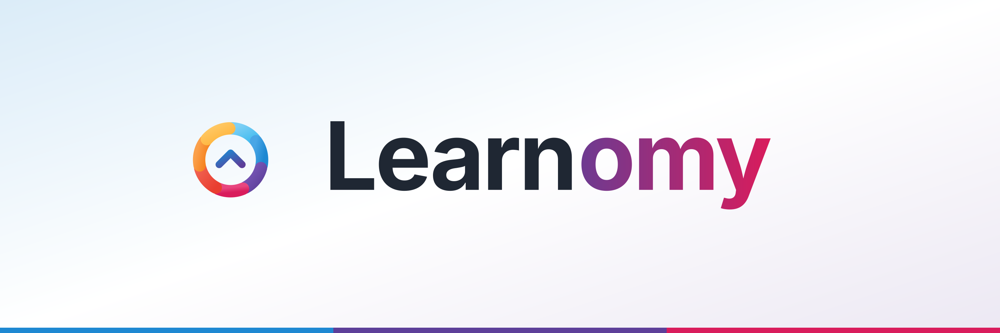
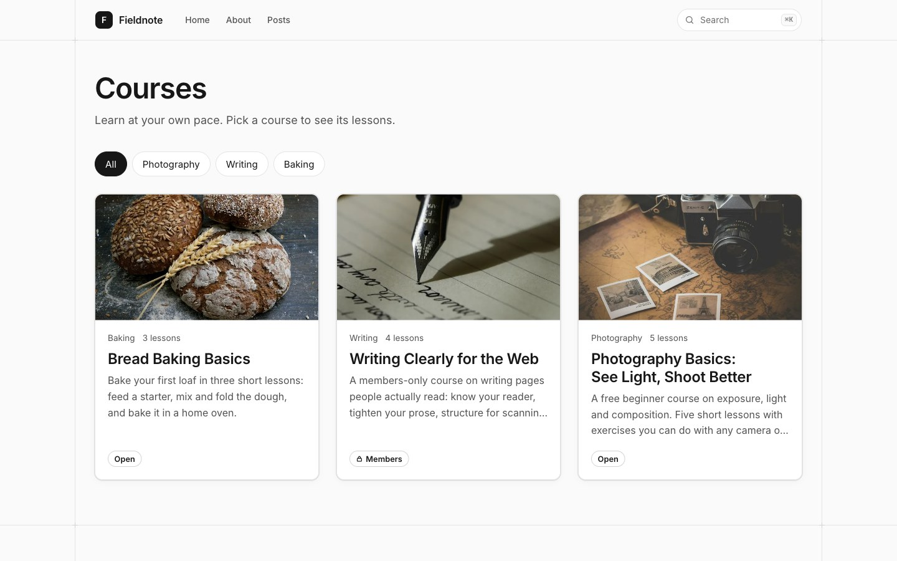
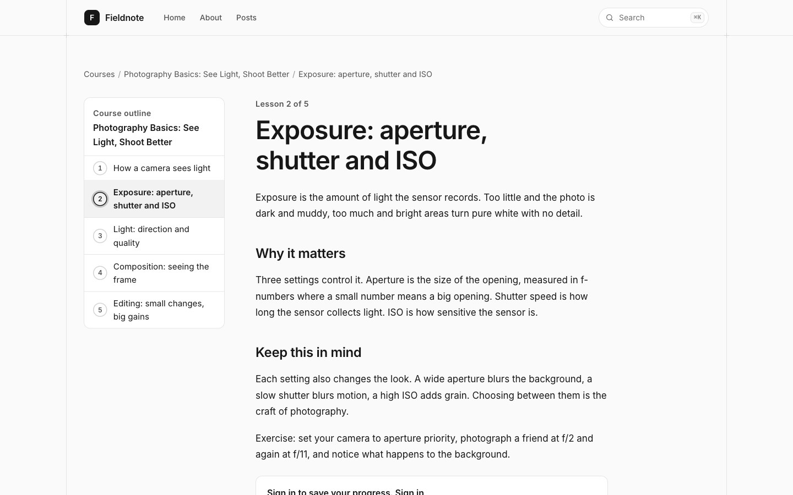
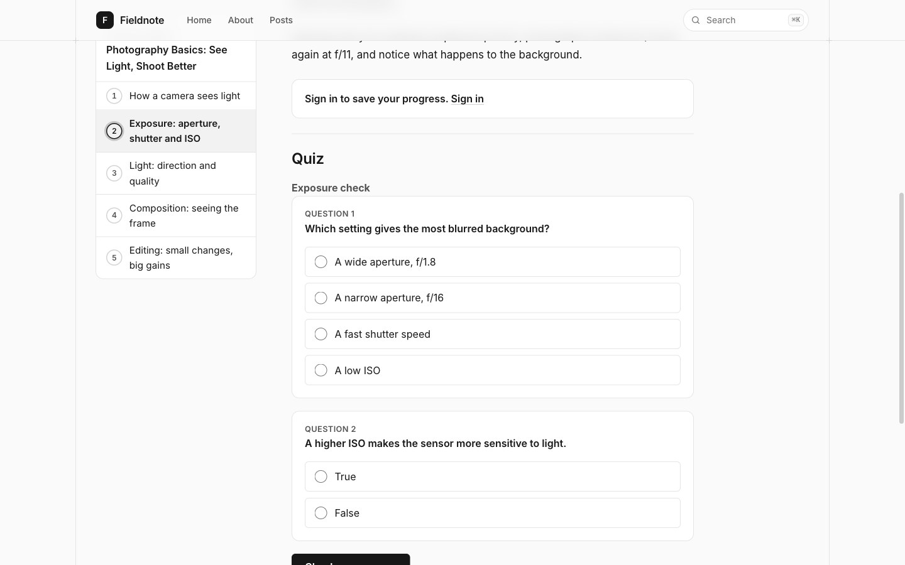
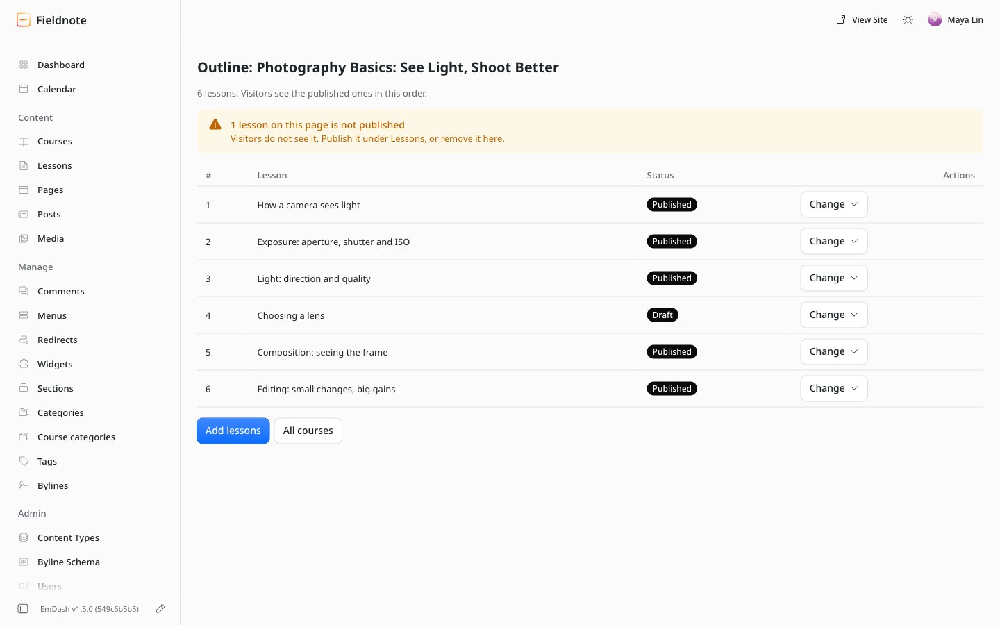
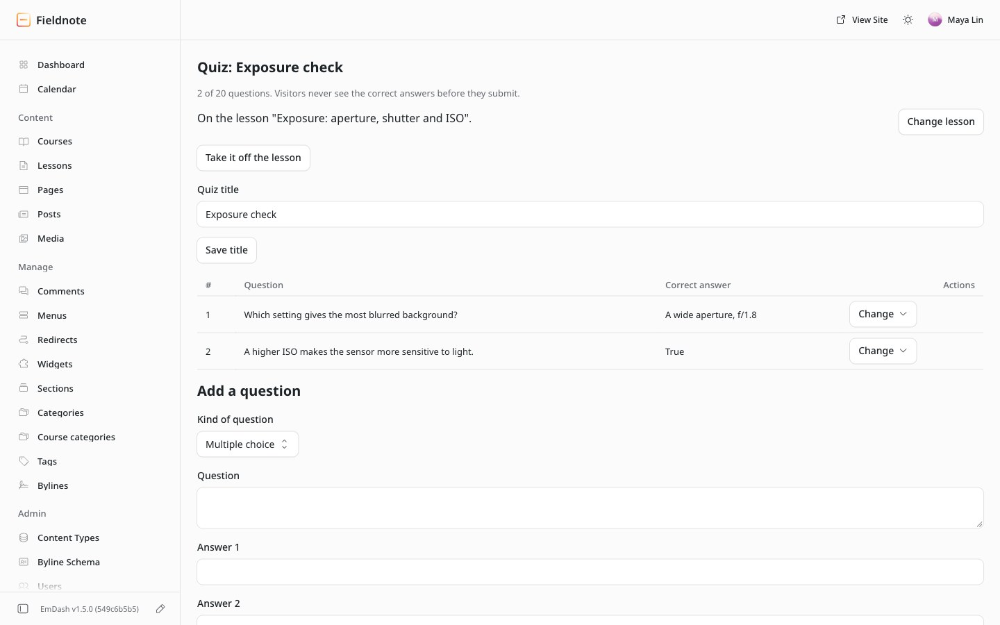

<h3 align="center">Free courses for your EmDash site</h3>

Write courses and lessons in EmDash's own editor. Members enroll for free, track their progress and take a short quiz after each lesson. No shop and no payments.

  <a href="https://plugins.emdashcms.com/plugins/@vapvarun.bsky.social/learnomy"><b>Install from the EmDash registry</b></a>
  &nbsp;·&nbsp;
  <a href="docs/website/getting-started/introduction.md">Read the docs</a>
  &nbsp;·&nbsp;
  <a href="https://github.com/wbcomdesigns/emdash-learnomy/releases">What's new</a>

## Who it is for

A teacher sharing what they know, a company training its team, or a publisher adding courses next to their articles. If you want courses on your EmDash site without running a shop, Learnomy is for you.

## What you get

**For you, the site owner**

- **Courses and lessons in the editor you already use.** Each course has a cover image, an excerpt and a category, under its own Courses and Lessons menus.
- **A Course outline page.** Pick a course, add its lessons by title and put them in order. Lessons that are not published yet are marked, so nothing half-finished reaches your members.
- **Open or Members courses.** Anyone can read an Open course. A Members course asks visitors to sign in first.
- **One quiz per lesson.** Multiple choice or true or false, up to 20 questions, written one question at a time.
- **Enrollments and Quiz results** with your members' names, and one click to erase a member's data when they ask.
- **A dashboard card** with your course, enrollment and quiz counts.

**For your members**

- **Free enrollment** and a clear "3 of 8 lessons done" on every course.
- **Lessons that are easy to read**, with the course outline beside the text on a big screen and folded away on a phone.
- **Quizzes scored on your site.** The right answers never reach the browser before a member submits.
- **Your courses**, a list of everything they are taking with Continue, on your site's account page.
- **A certificate for every finished course**, printable or saved as PDF, with a link they can share or turn off.

**For AI agents**

- Agents can create and publish courses and lessons through EmDash's own tools, and set outlines and write quizzes through Learnomy's eight agent tools once you turn them on. See [Build a course with agents](docs/website/developers/agents.md).

  
  

## Looks like your site

The course pages take their fonts, colours and spacing from your EmDash theme. They were checked on all four EmDash templates (blog, starter, marketing and portfolio) on desktop, tablet and phone, in light and dark. Want a different look? Change a few colour settings, any wording, or the page files themselves. See [Make it yours](docs/website/customize/make-it-yours.md).

  
  

## Get started

1. In your EmDash dashboard, open **Plugins**, then **Registry**, search for **Learnomy** and install it. It needs EmDash 1.5 or later.
2. Copy the course pages into your site once, as the [install guide](docs/website/getting-started/install.md) shows.
3. Write your first course, put its lessons in order on **Course outline**, and invite your first members.

## Good to know

- **Members join by invite for now.** You invite them from Users in your dashboard. Self-signup by email domain arrives as soon as EmDash ships its signup fix. See [Let members join](docs/website/getting-started/let-members-join.md).
- **Members keeps out visitors who are not signed in.** It does not hide one member's courses from another member. See [What Members means](docs/website/getting-started/what-members-means.md).
- **Free, with no paid version.** No prices or checkout. Learnomy grows as EmDash grows.

## Docs

- [Introduction](docs/website/getting-started/introduction.md)
- [Install](docs/website/getting-started/install.md)
- [Run your courses](docs/website/manage/admin-guide.md)
- [Make it yours](docs/website/customize/make-it-yours.md)
- [Build a course with agents](docs/website/developers/agents.md)
- [FAQ](docs/website/faq/faq.md) and [Troubleshooting](docs/website/troubleshooting/troubleshooting.md)

## More from Wbcom Designs for EmDash

[Listora](https://github.com/wbcomdesigns/emdash-listora) directories · [WB Reviews](https://github.com/wbcomdesigns/emdash-reviews) · [WB Polls](https://github.com/wbcomdesigns/emdash-polls) · [Product Roadmap](https://github.com/wbcomdesigns/emdash-roadmap) · [KnowX](https://github.com/wbcomdesigns/emdash-knowx)

Found a bug or have an idea? [Open an issue](https://github.com/wbcomdesigns/emdash-learnomy/issues). Want to build on Learnomy? Start with [CONTRIBUTING.md](CONTRIBUTING.md).

MIT licence. Made by [Wbcom Designs](https://wbcomdesigns.com).
