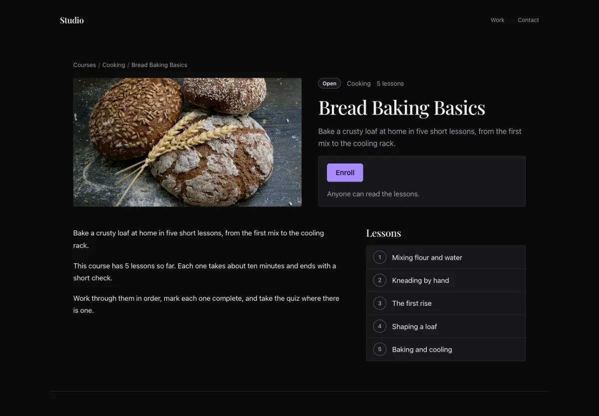

# Make it yours

**Included in Free.**

The course pages take your theme's font, text and link colours, corner radius and light or dark scheme on their own. When you want more, there are three levels, from easiest to most control: tokens, wording, markup.



## 1. Colours and sizes: tokens

All kit styles live in `src/styles/learnomy.css`, under `.learnomy`, and read their values from `--learnomy-*` tokens. Each token takes your theme's own value first and falls back to a neutral one. Set a token in your own stylesheet (for example `src/styles/theme.css`) and only the course pages change:

```css
.learnomy {
  --learnomy-brand: #0f766e;
  --learnomy-radius: 4px;
  --learnomy-measure: 36rem;
}
```

Your rule always wins, whatever order the stylesheets load in.

| Token | What it controls | Taken from your theme |
| --- | --- | --- |
| `--learnomy-text` | Body text | `--color-text` |
| `--learnomy-muted` | Secondary text: counts, dates, help lines | `--color-text-secondary`, `--color-muted` |
| `--learnomy-bg` | Page background behind the kit | `--color-bg` |
| `--learnomy-surface` | Cards and panels | `--color-surface` |
| `--learnomy-subtle` | Quiet fills: progress track, sign-in box | `--color-fill`, `--color-sunken` |
| `--learnomy-border` | Card and list borders | `--color-border` |
| `--learnomy-border-strong` | Inputs and stronger lines | `--color-border-strong` |
| `--learnomy-brand` | Buttons, progress bar, current lesson | `--color-brand` |
| `--learnomy-on-brand` | Text on top of `--learnomy-brand` | `--color-on-brand` |
| `--learnomy-danger` | Wrong answers, errors | `--color-danger` |
| `--learnomy-heading-font` | Heading font | `--font-heading` |
| `--learnomy-heading-weight` | Heading weight | `--font-weight-heading` |
| `--learnomy-radius` | Card corners | `--radius-lg`, `--radius` |
| `--learnomy-radius-sm` | Button and badge corners | `--radius-sm` |
| `--learnomy-shadow` | Card shadow | `--shadow-card` |
| `--learnomy-shadow-hover` | Card shadow on hover | `--shadow-card-hover` |
| `--learnomy-gap` | Space between cards and sections | `--spacing-md` |
| `--learnomy-max` | Widest the kit grows (72rem) | none |
| `--learnomy-gutter` | Space at the page sides | none |
| `--learnomy-measure` | Width of the lesson text column (40rem, about 70 characters) | none |
| `--learnomy-tap` | Smallest button and answer height (44px) | none |
| `--learnomy-cover-ratio` | Shape of course covers (16 / 9) | none |

### Dark mode on the portfolio template

The kit uses your theme's own button colours. The EmDash portfolio template's dark mode pairs a light purple with white text, which is hard to read. Fix it with one line in `src/styles/theme.css`:

```css
.learnomy { --learnomy-on-brand: light-dark(#ffffff, #1e1033); }
```

## 2. Wording: learnomy-strings.ts

Every phrase a visitor sees is in `src/lib/learnomy-strings.ts`: the catalog title, button labels, the sign-in prompt, empty and error messages. Change the text between the quotes and rebuild. Translate it the same way.

```ts
catalog: {
  title: "Workshops",
  lead: "Short, practical workshops. Pick one to begin.",
```

Keep a copy of your changes: copying the kit again after an update replaces this file.

## 3. Markup: the .astro files and data-learnomy-* hooks

The pages in `src/pages/courses/`, `src/pages/lessons/` and `src/components/LearnomyMyCourses.astro` are yours to change once copied. Every element carries a `data-learnomy-*` attribute, so your own CSS and scripts can reach it without depending on class names:

| Hook | Element |
| --- | --- |
| `data-learnomy-catalog`, `data-learnomy-grid`, `data-learnomy-card` | The catalog, its grid and each course card |
| `data-learnomy-filter`, `data-learnomy-filter-term` | The category filter and each category |
| `data-learnomy-badge` | The Open or Members badge |
| `data-learnomy-course`, `data-learnomy-hero`, `data-learnomy-course-progress` | The course page, its header and progress bar |
| `data-learnomy-enroll`, `data-learnomy-continue` | Enroll and Continue buttons |
| `data-learnomy-lessons`, `data-learnomy-step`, `data-learnomy-step-state` | The lesson list, each lesson and its done, current or to-do state |
| `data-learnomy-lesson`, `data-learnomy-body`, `data-learnomy-outline` | The lesson page, its text and the course outline beside it |
| `data-learnomy-mark`, `data-learnomy-prev`, `data-learnomy-next`, `data-learnomy-position` | Mark complete, previous and next lesson, "Lesson 3 of 8" |
| `data-learnomy-gate`, `data-learnomy-sign-in` | The sign-in prompt on a Members lesson |
| `data-learnomy-quiz`, `data-learnomy-question`, `data-learnomy-choice`, `data-learnomy-score` | The quiz, each question, each answer, the score |
| `data-learnomy-mine`, `data-learnomy-mine-row`, `data-learnomy-erase` | Your courses, each row, the erase button |

For example, to hide the category filter:

```css
[data-learnomy-filter] { display: none; }
```

If you change a page, copying the kit again replaces it. Keep your version and copy your changes back in after an update.
