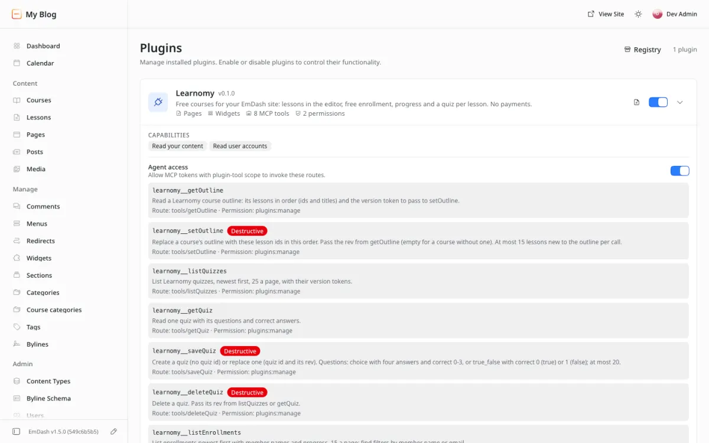

# Build a course with agents

**Included in Free.**

An AI agent (Claude, or any MCP client) can build a whole Learnomy course for you: the course, its lessons, their order and a quiz per lesson. It uses two sets of tools on your site's one MCP address, `https://<your site>/_emdash/api/mcp`:

- **EmDash's own tools** for courses and lessons, because they are ordinary entries: `content_create`, `content_update`, `content_publish`, `content_schedule`, `content_list` and the rest, on the `lms_courses` and `lms_lessons` collections.
- **Learnomy's tools** for outlines and quizzes, which live in plugin storage: `getOutline`, `setOutline`, `listQuizzes`, `getQuiz`, `saveQuiz`, `deleteQuiz`, `listEnrollments`, `listResults`.

## Set up once

### 1. Turn on Learnomy's tools

Plugin tools are off until you turn them on.

1. In the dashboard, open **Plugins** and expand **Learnomy**. Its card says "8 MCP tools".
2. Under **Agent access**, turn the switch on. Each tool is listed with what it does. `setOutline`, `saveQuiz` and `deleteQuiz` are marked **Destructive** because they replace or delete.



**After an update that changes the tools,** EmDash asks for your consent again before agents can use them. Open the card and turn **Agent access** on again if it is off.

### 2. Give the agent a token

Open **Settings**, **API Tokens** and create a token for the agent with these scopes:

- The content scopes EmDash offers for reading and writing content, so it can create and publish courses and lessons.
- **Invoke MCP tools from the learnomy plugin** (`mcp:tools:<plugin id>`, for example `mcp:tools:learnomy`). This lets the token call Learnomy's tools and no other plugin's.

Give the token only to the agent, and delete it when the work is done.

### 3. Connect the agent

Add the MCP address and the token to your agent. For Claude Code:

```bash
claude mcp add --transport http my-site https://example.com/_emdash/api/mcp \
  --header "Authorization: Bearer <token>"
```

Learnomy's tools show up named after the plugin, for example `learnomy__setOutline`.

## Build a course, end to end

Ask the agent in plain words, for example: "Make a five-lesson Open course called Bread Baking Basics, with a three-question quiz on every lesson." The agent works in this order:

1. **Lessons.** `content_create` on `lms_lessons` for each lesson: `title`, `content` and an `excerpt` for search engines (a summary, never the lesson text). Then `content_publish` each one, or `content_schedule` to release one a week. Both need the entry's current `_rev`: call `content_get` first and pass its `_rev`, or EmDash refuses the call. Keep each lesson's entry id.
2. **Course.** `content_create` on `lms_courses` with `title`, `excerpt`, `content`, `access` (`open` or `members`) and a cover image, then `content_get` for its `_rev` and `content_publish`. Keep the course id.
3. **Outline.** `getOutline` with the course id returns the current lessons and a version token `rev` (empty for a new course). `setOutline` with `course`, `lessons` (the lesson ids in order) and that `rev`. Up to 15 lessons new to the outline per call; for a longer course, call `getOutline` and `setOutline` again with the next lessons added. A course holds up to 200.
4. **Quizzes.** For each lesson, `saveQuiz` with `title`, `lesson` (the lesson id) and `questions`. Each question is either
   - `{ "type": "choice", "prompt": "...", "answers": ["A", "B", "C", "D"], "correct": 2 }` (four answers, `correct` 0 to 3), or
   - `{ "type": "true_false", "prompt": "...", "correct": 0 }` (0 true, 1 false).

   Up to 20 questions. A lesson that already has a quiz is refused. To change a quiz, `getQuiz` for its `rev`, then `saveQuiz` with `quiz`, `rev` and the full new questions.
5. **Check.** `getOutline` again, and open `/courses/` on the site.

Later, `listEnrollments` and `listResults` give the agent who enrolled and how they scored, 15 a page, with `find` for a name or email.

## Version tokens

`setOutline`, `saveQuiz` (replace) and `deleteQuiz` need the `rev` the agent last read. If you or another agent changed the same outline or quiz in between, the call is refused with "Someone else changed this...". The agent reads it again and retries. Nothing is overwritten by accident.

## What agents cannot do

Members join by your invite (see [Let members join](../getting-started/let-members-join.md)); an agent does not create member accounts. The tools never enroll members or change their progress.
