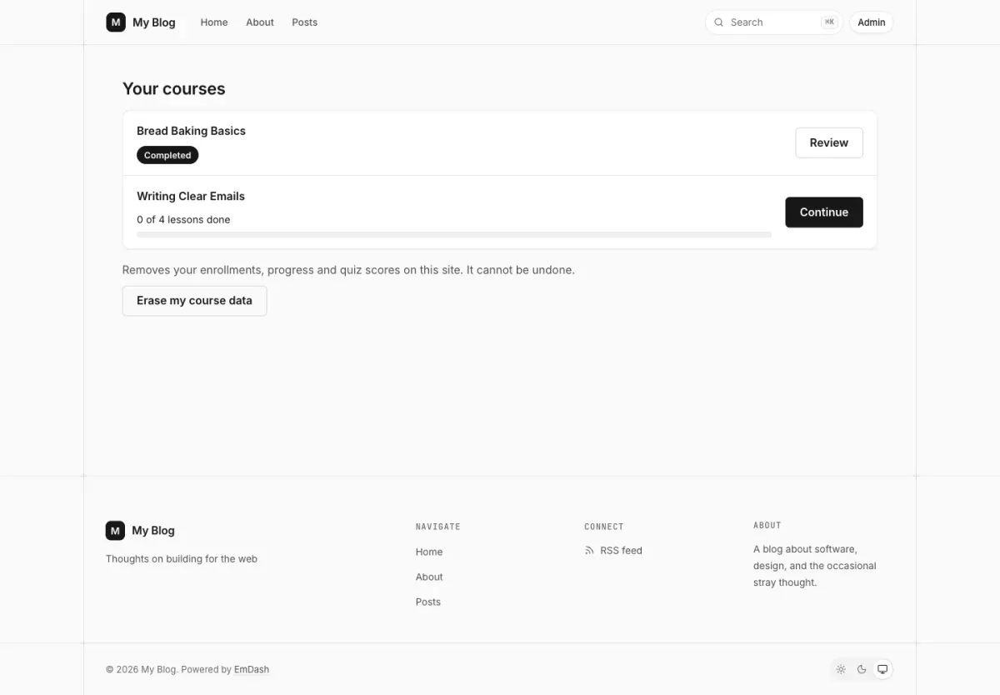

# Install Learnomy

**Included in Free.** Learnomy has no paid version.

Installing takes two parts: the plugin in the dashboard, then the site kit in your site's code. The second part needs someone who can edit the site's files.

Learnomy needs EmDash 1.5.0 or later. Checked on EmDash 1.5.0 with the `blog` template on Node.

## Before you install

**1. Your site needs a sandbox runner.** Registry plugins run in a sandbox. Until the site has one, Plugins shows "No plugins configured" and there is no **Registry** in the menu.

- **Node:** in your site, run `npm install @emdash-cms/sandbox-workerd workerd`, then add `sandboxRunner: "@emdash-cms/sandbox-workerd/sandbox",` inside `emdash({ ... })` in `astro.config.mjs`.
- **Cloudflare:** add `import { sandbox } from "@emdash-cms/cloudflare";` and `sandboxRunner: sandbox(),`. It needs the Workers Paid plan, the `worker_loaders` binding named `LOADER` (uncomment it in your Wrangler config) and an R2 bucket as `storage: r2(...)`. Then run `npm run deploy`.

Stop the dev server and start it again. **Registry** now shows in the dashboard menu.

**2. The plugin is the engine. Visitor pages come from its site kit.** Until you copy the kit, `/courses/` shows your site's 404 page. That is expected.

**3. Pages named `courses` or `lessons`.** If your site already has a page with either slug, the kit's pages would hide it. Rename it first.

## Step 1: install the plugin

1. In the dashboard, open **Plugins**, then **Registry**. Search **Learnomy**, press Install and accept the two permissions:
   - **Read your content**, so Learnomy can list your courses and lessons by title and show only published ones to visitors.
   - **Read user accounts**, so the Enrollments and Quiz results lists show member names instead of ids.
2. Four pages appear in the dashboard menu under **Plugins**, next to other plugins' pages: **Course outline**, **Quizzes**, **Enrollments** and **Quiz results**. A Learnomy card appears on the dashboard.

## Step 2: copy the site kit

From your site's root folder, run this. It gets the kit for the version you installed, copies it in, and adds the **Courses**, **Lessons** and **Course categories** content types to your site:

```bash
kit="$(mktemp -d)/emdash-learnomy" &&
  git clone --depth 1 --branch v0.1.0 https://github.com/wbcomdesigns/emdash-learnomy "$kit" &&
  mkdir -p src/pages src/components src/lib src/styles src/layouts &&
  cp -R "$kit/site-kit/pages/." src/pages/ &&
  cp "$kit/site-kit/components/LearnomyMyCourses.astro" src/components/ &&
  cp "$kit/site-kit/lib/learnomy.ts" "$kit/site-kit/lib/learnomy-strings.ts" src/lib/ &&
  cp "$kit/site-kit/styles/learnomy.css" src/styles/ &&
  { [ -e src/layouts/LearnomyLayout.astro ] || cp "$kit/site-kit/layouts/LearnomyLayout.astro" src/layouts/; } &&
  shared() { sed -n '1s/.*wbcom-shared: \([0-9]*\).*/\1/p' "$1" 2>/dev/null || true; } &&
  { [ "$(shared src/lib/wbcom-kit.ts)" -ge "$(shared "$kit/site-kit/lib/wbcom-kit.ts")" ] 2>/dev/null || cp "$kit/site-kit/lib/wbcom-kit.ts" src/lib/; } &&
  npx emdash seed "$kit/site-kit/seed/learnomy-seed.json" --no-content
```

What it copies:

| File | What it is |
| --- | --- |
| `src/pages/courses/index.astro`, `src/pages/courses/[slug].astro`, `src/pages/lessons/[slug].astro` | The catalog, the course page and the lesson page with its quiz |
| `src/components/LearnomyMyCourses.astro` | Your courses, for the account page (step 3) |
| `src/lib/learnomy.ts` | How the pages talk to the plugin |
| `src/lib/learnomy-strings.ts` | Every phrase a visitor sees. Reword or translate it here |
| `src/styles/learnomy.css` | The kit's styles, built on `--learnomy-*` tokens |
| `src/layouts/LearnomyLayout.astro` | Hands every Learnomy page to your site's `src/layouts/Base.astro`. Copied only the first time, so your changes stay |
| `src/lib/wbcom-kit.ts` | Shared by every Wbcom plugin. Copied only when your site has no copy or an older one (the number on its first line, `wbcom-shared: N`) |

If your site's layout is not called `Base.astro`, or takes other props, change the one import in `src/layouts/LearnomyLayout.astro`. Nothing else needs to change.

Restart the dev server, or deploy.

## Step 3: put Your courses on the account page

Members see their courses through the `LearnomyMyCourses` component. Learnomy has no account page of its own: it goes on your site's shared account page, next to what other plugins put there.

If your site already has an account page (other Wbcom plugins use `src/pages/account/index.astro`), add these two lines to it:

```astro
---
import LearnomyMyCourses from "../../components/LearnomyMyCourses.astro";
---
<LearnomyMyCourses />
```

If your site has no account page yet, create `src/pages/account/index.astro`:

```astro
---
import Layout from "../../layouts/LearnomyLayout.astro";
import LearnomyMyCourses from "../../components/LearnomyMyCourses.astro";
---
<Layout title="Your account">
  <LearnomyMyCourses />
</Layout>
```

The import path depends on where the file sits: `../../` from `src/pages/account/`, `../` from a file directly in `src/pages/`.



## Step 4: link it

In **Menus**, add a link to `/courses/`, and one to your account page if your menu has none.

## Step 5: write your first course

1. Under **Lessons**, write two or three lessons and publish them.
2. Under **Courses**, write a course, set **Who can read the lessons** to `open` or `members`, add a cover image and publish it.
3. In **Plugins**, **Course outline**, pick the course and add the lessons in order.
4. Open `/courses/` on your site.

Then [let members join](let-members-join.md) so they can enroll.

## After every update

Run step 2 again with the new version's tag in place of `v0.1.0`. It replaces the kit's pages, styles and wording file and keeps your layout file. If you changed `learnomy-strings.ts` or a kit page, copy your changes back in after.
