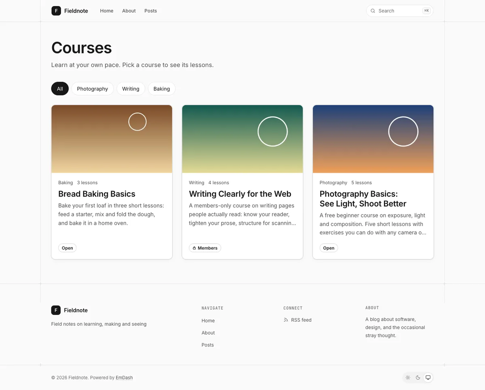

# Introduction

**Included in Free.** Learnomy has no paid version and takes no payments.

Learnomy adds free courses to your EmDash site. You write courses and lessons in EmDash's own editor, put the lessons of each course in order, and add a short quiz to any lesson. Members enroll for free, mark lessons complete, see their progress and take the quizzes.

## Who it is for

A teacher, a company training its staff, or a publisher who wants courses on their site without a shop.

## What you get

- **Courses and lessons in the editor you already use.** They sit under their own **Courses** and **Lessons** menus in the dashboard, with a cover image, an excerpt and a category for each course.
- **A Course outline page** where you pick a course, add its lessons by title and set their order.
- **Open or Members courses.** Anyone can read an Open course. A Members course asks guests to sign in. See [What Members means](what-members-means.md).
- **Free enrollment and progress.** Members enroll, mark each lesson complete and see "3 of 8 lessons done". A course is finished when every lesson is done.
- **One quiz per lesson.** Multiple choice with four answers, or true or false, up to 20 questions. The score is worked out on your site, so visitors never see the right answers before they submit.
- **Certificates.** A member who finishes a course gets a printable certificate with a link to share. See [Certificates](../manage/admin-guide.md#certificates).
- **Your courses** for members: a list of their courses with progress and Continue, on your site's account page.
- **Lists for you:** Enrollments and Quiz results, with names, and an erase button for one member's data.
- **Ready for AI agents.** An agent can build a whole course for you. See [Build a course with agents](../developers/agents.md).

## How it fits together

The plugin is the engine: it stores enrollments, progress and quizzes and draws the admin pages. An EmDash plugin cannot add pages to your site, so the course pages visitors see come as a **site kit** that you copy into your site once. The [install guide](install.md) covers both parts.

## What it does not do

No prices, checkout or coupons. Members join by your invite for now: see [Let members join](let-members-join.md).
