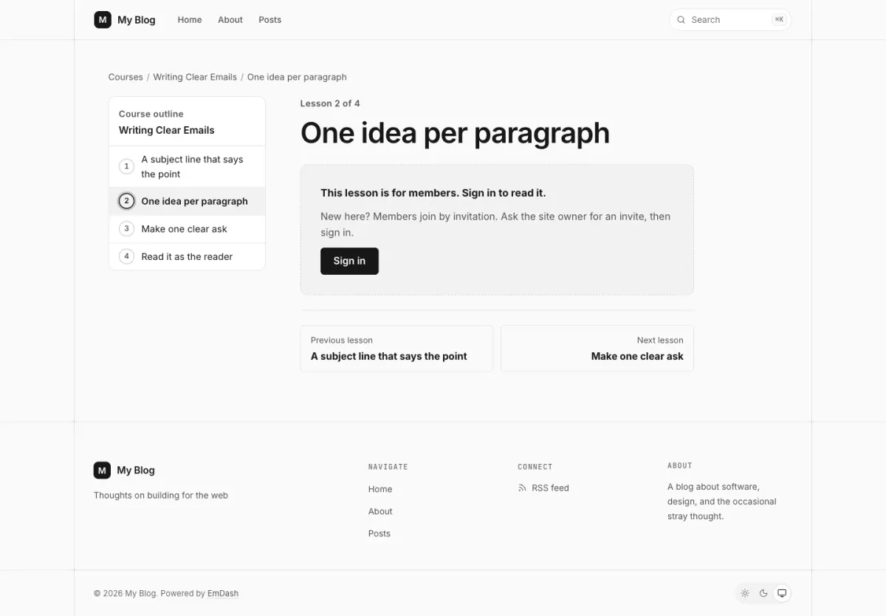

# What Members means

**Included in Free.**

Every course is either **Open** or **Members**. You choose on the course, in its **Who can read the lessons** field (`open` or `members`). A course with no value in that field (one made through the API without it, for example) is treated as **Members** on every page, badge and route, so nothing is shown to guests by mistake.

| | Open | Members |
| --- | --- | --- |
| Guests read the course page and lesson titles | Yes | Yes |
| Guests read the lesson text | Yes | No, they are asked to sign in |
| Signed-in members read the lesson text | Yes | Yes |
| Guests read the lesson's quiz questions | Yes | No, they are asked to sign in |
| Enroll, mark complete, submit quizzes | Signed-in members | Signed-in members |

## Members keeps out guests, not other members

Members means "signed in". It does not mean "enrolled in this course". Anyone with an account on your site can read every published lesson of every Members course, enrolled or not. That is how EmDash shares published content with signed-in people, and Learnomy cannot change it.

So:

- Use Members to keep lessons away from the public and search engines.
- Do not use it to sell a course or to hide one course from members of another. Anything published is readable by every member.

## How the lesson text stays away from guests

For a Members course, the lesson page on your site carries only the title. The text is loaded in the visitor's browser after they sign in. Nothing of it is in the page a guest or a search engine receives, in your sitemap, your feed or your site search. The lesson's excerpt is used for search engines, so never put lesson text in the excerpt.

The lesson's quiz is protected the same way: a guest can read the questions only of a lesson that is in an Open course.

If your site turns on route caching, an Open lesson's page is never cached (it holds the lesson text), and a Members lesson page is cached for a minute at most, so switching a course to Members takes effect at once.

## A lesson in more than one course

A lesson can sit in several course outlines. Its access comes from the course the visitor came through. When someone opens a lesson without a course (from search, for example), the page finds the course it belongs to, Open courses first.
