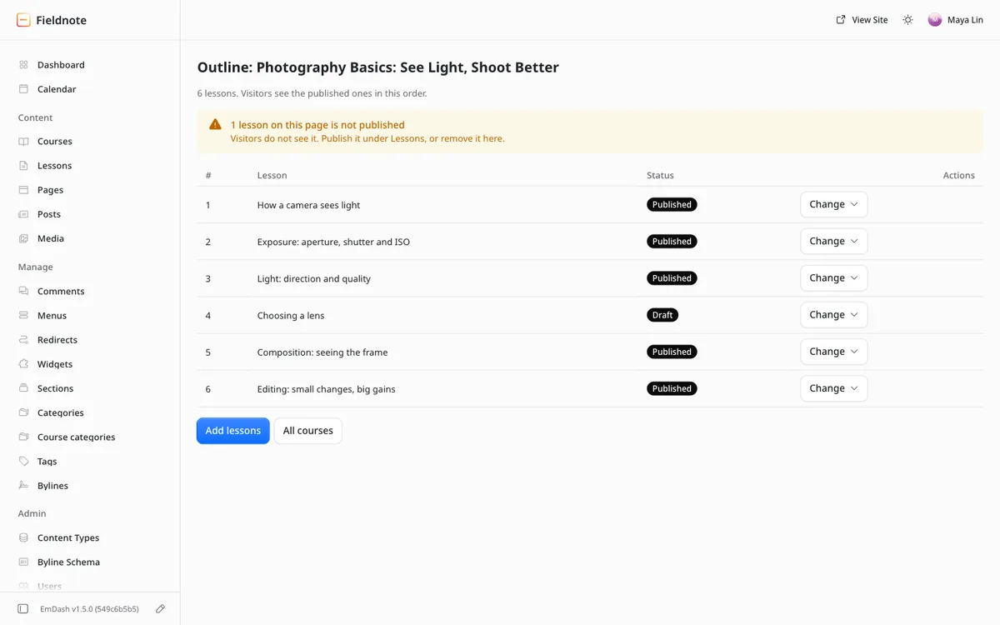
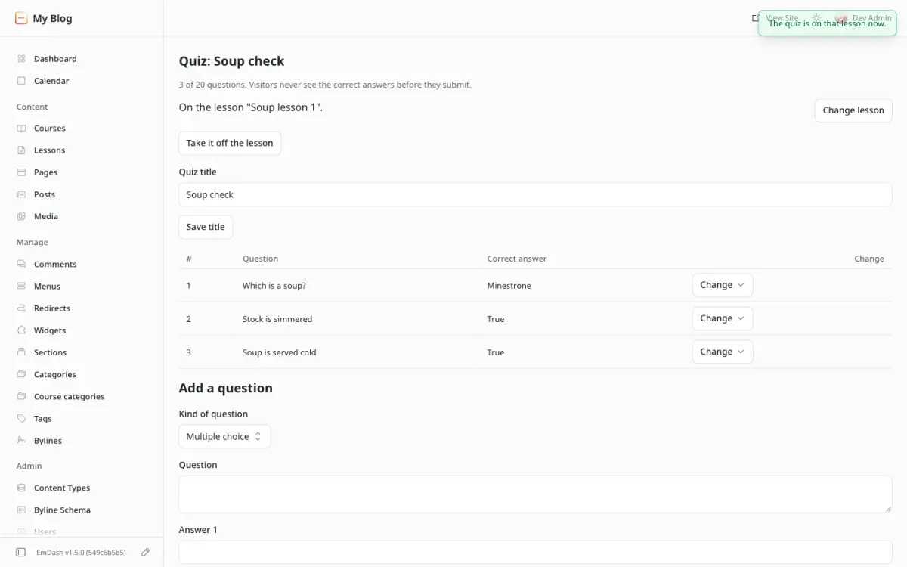
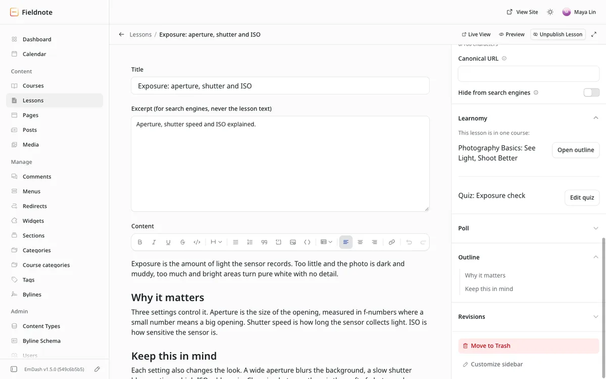
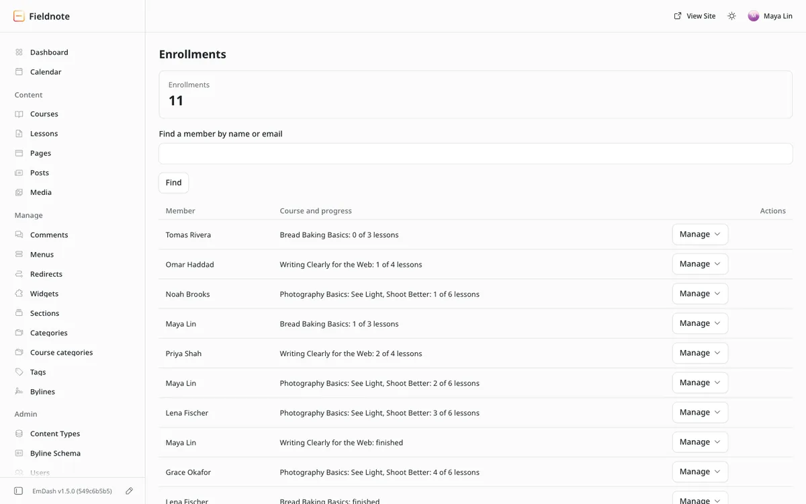

# Run your courses

**Included in Free.**

Everything here happens in the EmDash dashboard, with no code.

## Courses and lessons

Courses and lessons are ordinary EmDash entries, written in EmDash's own editor.

- **Courses** (menu: Courses): a title, an excerpt for the catalog card, the course text, a cover image, a category under **Course categories**, and **Who can read the lessons** (`open` or `members`, see [What Members means](../getting-started/what-members-means.md)).
- **Lessons** (menu: Lessons): a title, the lesson text, and an excerpt. The excerpt is what search engines see. Never put lesson text in it.

Save drafts, schedule and publish as you would a post. Visitors see only published courses and published lessons.

A lesson has no course field. Which lessons belong to a course, and in what order, is set on the Course outline page.

## Course outline

**Plugins**, **Course outline**. Pick a course from the list of your courses. The outline shows its lessons in order, ten to a page.

- **Add lessons** lists your lessons by title. Press **Add** next to each lesson you want. New lessons go to the end.
- **Change** on a row moves the lesson up or down, or removes it from the course. Removing it from the course does not delete the lesson.
- A lesson that is not published is marked **Draft**, and a note at the top says visitors do not see it. Publish it under Lessons, or remove it here.
- If someone else changed the same outline since you opened it, your change is refused and the outline reloads. Make your change again.

A course holds up to 200 lessons. A lesson can be in more than one course.

## Quizzes

**Plugins**, **Quizzes**. Each lesson can have one quiz.

1. Type a title under **New quiz title** and press **Create quiz**.
2. Press **Choose lesson** and pick the lesson the quiz belongs to. A lesson that already has a quiz says which. **Change lesson** moves the quiz; **Take it off the lesson** hides it from visitors.
3. Set the quiz under **Mode**, **Pass mark** and **Retakes**, then press **Save settings**:
   - **Graded** (the default) or **Practice**. A practice quiz never holds anyone back. After submitting, members see the right answer to each question and your explanation.
   - **Pass mark**: a percent from 1 to 100, or 0 for none. With a pass mark, a member must reach it on this graded quiz before they can mark its lesson complete, so a course only finishes once all its quizzes are passed. Their best score counts. Scores round down, so 2 of 3 is 66%.
   - **Retakes**: **Unlimited**, **A maximum number of attempts** (then the number), or **A wait before each retry** (then the minutes, up to 30 days).
4. Under **Add a question**, pick the kind of question. Each kind shows its own fields:
   - **Multiple choice (one answer)**: the question and four answers, then the correct answer.
   - **Multiple answers (pick all that apply)**: the question and four answers, then tick every right answer.
   - **True or false**: the question, then whether it is true or false.
   - **Short answer**: the question, then the accepted answers, one per line.
   - **Fill in the blank**: the question with three underscores where the blank goes, for example "Water boils at ___ degrees.", then the accepted answers, one per line.

   Typed answers are marked right when they match an accepted answer, ignoring capitals and extra spaces. **Explanation** is optional; members see it after a practice quiz.
5. Press **Save question**. Add the next one the same way. A quiz holds up to 20 questions.
6. **Change** on a question edits or removes it.

Visitors see the quiz under its lesson. They never see the correct answers before they submit, and the score is worked out on your site. Members see their best score, whether they passed, how many attempts are left and when they can try again. Each member's attempts on a quiz are kept together: the latest answers, the number of attempts, the best score and the last 20 attempts.

A lesson a member already marked complete stays complete if you add a pass mark later.

To delete a quiz, open it and press **Delete quiz**, then confirm. Its lesson shows no quiz after that, and its results stay in Quiz results.

## The lesson editor panel

When you edit a lesson, the **Learnomy** panel beside the editor shows which courses the lesson is in, with **Open outline** for each, and the lesson's quiz with **Edit quiz**.

## Enrollments and Quiz results

**Enrollments** lists who enrolled in which course and how far they are: lessons done of the lessons in the course outline, or **Finished**. **Quiz results** lists each member's latest score on each quiz, their best score and how many attempts they made. Both show the newest first, 15 rows a page, with **Previous page** and **Next page**.

To find one member, type part of their name or their email in **Find a member by name or email** and press **Find**. The count above the list shows the matches, and **Next page** pages through all of them. A name is looked up among the first 500 members, up to 80 of them; an email finds anyone. Clear the box and press Find to see everything again.

## Erase one member's data

On Enrollments or Quiz results, open **Manage** on the member's row and choose **Erase their data**. A member who took a quiz without enrolling is on Quiz results only, so erase them from there. The page asks once, with their name. Erasing here deletes every enrollment, quiz result and past attempt of that member, including the record of attempts used that their own erase keeps, so use it to reset a member's retake limits or to honour a full deletion request. A member who erased their own data has no rows left: type their name or email in Find on Quiz results and their row appears with **Manage**. It cannot be undone. Their site account stays.

A member with a very long history may need a second press: the page says "Press Erase again to finish".

Members can also erase their own Learnomy data from Your courses on your site. That removes their enrollments, progress, answers and scores. For quizzes with a maximum number of attempts or a wait, it keeps only how many attempts they used and when, so erasing never resets a limit.

## The dashboard card

The **Learnomy** card on the dashboard shows how many courses are published, how many enrollments and how many quiz results there are, with a **New course** button and a **Course outline** link.
